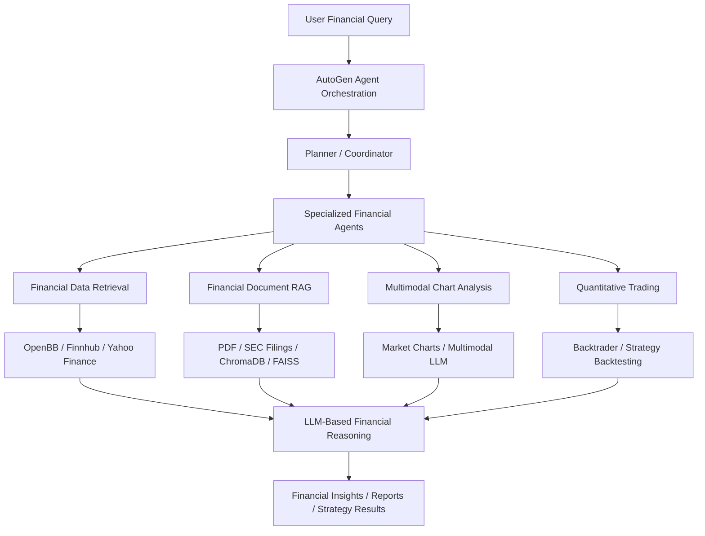

# Financial AI Agent Platform
### LLM-Powered Financial Research, Multi-Agent Intelligence, RAG & Algorithmic Trading

An AI-powered financial research and analysis project built around Large Language Models (LLMs), autonomous AI agents, financial data providers, Retrieval-Augmented Generation (RAG), multimodal market analysis, and algorithmic trading workflows.

This project explores how modern AI technologies can be applied to financial markets by combining **AutoGen multi-agent orchestration, FinRobot, OpenBB, LLM-based reasoning, financial knowledge retrieval, market data analysis, SEC filing intelligence, and quantitative backtesting**.

The goal is to build intelligent workflows capable of retrieving financial information, analyzing companies and markets, interpreting financial documents and charts, generating research reports, and developing and evaluating trading strategies.

---

## Key Capabilities

### 1. Multi-Agent Financial Intelligence

Leverages Microsoft's AutoGen to build collaborative AI-agent workflows in which specialized agents perform different financial tasks.

Implemented agent workflows include:

- **Market Analyst:** Analyzes companies, market conditions, financial developments, and potential investment risks.
- **Data Provider:** Retrieves financial data and prepares market information for downstream analysis.
- **Trade Strategist:** Develops algorithmic trading strategies and generates Python code for backtesting.
- **Backtesting Analyst:** Reviews strategy performance and supports iterative strategy optimization.
- **Planner / Tool Proxy Agents:** Break down financial questions into subtasks and coordinate financial-data tool execution.
- **Expert Investor:** Performs company-level investment research and financial analysis.
- **Report Generation Agents:** Analyze annual reports and prepare structured financial research documents.

AutoGen supports agent communication, tool execution, nested conversations, task delegation, and multi-step workflows.

### 2. Financial Data Intelligence with OpenBB

Integrates OpenBB as a financial data access and analysis layer.

The project explores programmatic access to multiple financial data categories, including:

- Equities and stock market data
- Options
- Cryptocurrency
- Foreign exchange (Forex)
- Macroeconomic indicators
- Fixed-income data
- Financial market information from supported providers

Additional capabilities include:

- Natural-language financial queries
- Function calling for financial data retrieval
- OpenBB documentation retrieval
- DSPy-based OpenBB agent workflows
- Financial query routing and graph-based organization of available tools
- Structured financial outputs, including tables and analytical results

The OpenBB agent workflow uses LLM-based planning to decompose financial questions and retrieve relevant information through registered tools.

### 3. Retrieval-Augmented Generation (RAG) for Financial Knowledge

Implements document-grounded question-answering workflows for financial information.

The project includes multiple retrieval-oriented experiments:

**AutoGen RAG**
- Uses AutoGen's retrieval capabilities.
- Explores document-based question answering through `SingleAssistantRAG` and RetrieveChat workflows.

**PDF-Based Financial RAG**
- Extracts text from financial PDF documents.
- Splits documents into smaller text chunks.
- Generates semantic embeddings using Sentence Transformers.
- Uses FAISS for vector similarity search.
- Retrieves relevant document passages.
- Uses an LLM to generate context-grounded answers.

**OpenBB Documentation RAG**
- Uses ChromaDB for vector-based document retrieval.
- Integrates OpenBB documentation with an LLM-based financial agent.
- Explores DSPy-based orchestration and financial function calling.
- Uses document and tool-routing structures to support financial queries.

These workflows demonstrate how financial knowledge bases can support more context-aware research and question answering.

### 4. SEC Filings & Financial Statement Analysis

Uses financial documents and company filings to support structured corporate research.

Implemented workflows include:

- SEC 10-K annual report analysis
- Company business overview and market-position analysis
- Financial performance analysis
- Risk assessment
- Competitor comparison
- Financial metrics interpretation
- Company valuation discussion
- Automated financial report generation

The annual-report workflow can retrieve filing information, analyze company and competitor data, and generate formatted PDF reports.

### 5. Multimodal Financial Market Analysis

Explores the use of vision-capable LLM agents to interpret financial charts.

Using AutoGen's `MultimodalConversableAgent` and financial charting tools, the workflow:

- Retrieves market data.
- Generates candlestick charts.
- Visualizes price movements and trading volume.
- Passes chart images to a multimodal LLM agent.
- Analyzes visible market patterns.
- Produces market commentary and potential trend assessments.

This approach demonstrates the application of multimodal AI to financial time-series visualization and market research.

### 6. Market Forecasting & Financial News Analysis

Integrates market data and financial information to support company-level analysis.

The project explores:

- Historical stock-price retrieval
- Company news retrieval
- Market trend analysis
- Positive and negative development identification
- Investment risk assessment
- LLM-generated market commentary
- Short-term directional market assessments

Data access is explored through providers and libraries such as Finnhub and Yahoo Finance, subject to provider availability and API access.

### 7. Algorithmic Trading & Backtesting

Uses Backtrader and AutoGen-based agents to develop and evaluate quantitative trading strategies.

Implemented workflows include:

- AI-assisted trading strategy generation
- Python code generation for trading strategies
- SMA Crossover strategy development
- Custom indicator and position-sizing exploration
- Historical market-data analysis
- Backtesting
- Strategy parameter optimization
- Backtest visualization
- Comparison against Buy-and-Hold benchmarks
- Iterative strategy refinement

The Trade Strategist agent can generate strategy code, execute backtesting tools, inspect results, and revise strategies based on observed performance.

---

## Technology Stack

| Category | Technologies |
|---|---|
| Programming Language | Python |
| Large Language Models | GPT-based LLMs |
| Multi-Agent Orchestration | Microsoft AutoGen |
| Financial AI | FinRobot |
| Financial Data Platform | OpenBB |
| Agent Tool Calling | Function Calling, AutoGen Toolkits |
| RAG Frameworks | AutoGen RetrieveChat, Custom RAG Workflows |
| Vector Databases / Search | ChromaDB, FAISS |
| Embeddings | Sentence Transformers, all-MiniLM-L6-v2 |
| LLM Orchestration / Optimization | DSPy, LangChain integrations |
| Financial Data APIs | Finnhub, Yahoo Finance, Financial Modeling Prep |
| Financial Documents | SEC 10-K Filings |
| Quantitative Trading | Backtrader |
| Data Processing | Pandas, NumPy |
| Financial Visualization | Matplotlib, mplfinance |
| Graph Processing | NetworkX, Graphviz |
| PDF Processing | PyMuPDF, PyPDF2 |
| Report Generation | ReportLab |
| Configuration & Secrets | Python dotenv |

---

## High-Level Architecture



---

## Example Use Cases

| Use Case | Example |
|---|---|
| Company Research | Analyze Microsoft's financial performance, business developments, and potential risks. |
| Stock Market Intelligence | Retrieve and interpret market information for selected tickers. |
| Financial Question Answering | Ask questions about annual reports and financial PDF documents using RAG. |
| Competitor Analysis | Compare companies using financial metrics and SEC filings. |
| Market Chart Interpretation | Analyze candlestick charts and trading volume with multimodal LLM agents. |
| Financial Data Exploration | Retrieve equity, options, crypto, Forex, and macroeconomic information through OpenBB. |
| Trading Strategy Development | Generate and test SMA Crossover strategies using Backtrader. |
| Strategy Optimization | Experiment with trading parameters and compare results with Buy-and-Hold. |
| Automated Research Reports | Generate structured company and competitor analysis reports in PDF format. |

---

## Project Objectives & Engineering Focus

This project demonstrates practical exploration of several important AI engineering concepts:

- Designing collaborative multi-agent systems.
- Connecting LLMs to external financial tools and APIs.
- Building tool-calling and task-delegation workflows.
- Developing document-grounded RAG pipelines.
- Working with vector databases and semantic embeddings.
- Applying multimodal LLMs to financial chart interpretation.
- Integrating structured and unstructured financial data.
- Automating financial research and report generation.
- Using LLM agents to generate and evaluate Python trading strategies.
- Connecting language-model reasoning with quantitative finance workflows.

The project is particularly relevant to **AI Engineering, LLM Engineering, Agentic AI, Financial AI, RAG Engineering, and Intelligent Automation**.

---

## Evaluation Considerations

For quantitative assessment and future extensions, relevant evaluation metrics include:

**RAG Evaluation**
- Recall@K
- Precision@K
- Mean Reciprocal Rank (MRR)
- Faithfulness
- Answer Relevance

**Trading Strategy Evaluation**
- Cumulative Return
- Compound Annual Growth Rate (CAGR)
- Sharpe Ratio
- Maximum Drawdown
- Win Rate
- Profit Factor
- Buy-and-Hold Benchmark Comparison

These metrics are recommended evaluation criteria; this repository does not claim a single consolidated benchmark result across all implemented workflows.

---

## Repository Structure

The project is organized around practical notebooks and experimental workflows.

```text
financial-ai-agent-platform/
│
├── tutorials_beginner/
│   ├── agent_annual_report.ipynb
│   ├── agent_rag_qa.ipynb
│   ├── agent_fingpt_forecaster.ipynb
│   └── ollama_stock_chart.ipynb
│
├── tutorials_advanced/
│   ├── agent_fingpt_forecaster.ipynb
│   ├── agent_trade_strategist.ipynb
│   ├── agent_openbb.ipynb
│   └── lmm_agent_mplfinance.ipynb
│
├── openbb-agent/
│   └── Financial data retrieval and agent workflows
│
├── report/
│   └── Generated financial reports and charts
│
├── coding/
│   └── Generated trading strategy code
│
├── requirements.txt
├── .env.example
└── README.md
```

*Note: This structure describes the main workflow organization. Keep only directories and files that are actually included in the published repository.*

---

## Setup & Configuration

### 1. Clone the repository

```bash
git clone https://github.com/YOUR_USERNAME/financial-ai-agent-platform.git
cd financial-ai-agent-platform
```

### 2. Create a virtual environment

```bash
python -m venv venv
```

Activate it:

```bash
# Linux / macOS
source venv/bin/activate

# Windows
venv\Scripts\activate
```

### 3. Install dependencies

```bash
pip install -r requirements.txt
```

Some workflows may require additional packages or compatible versions depending on the notebook.

### 4. Configure API keys

Create a `.env` file based on `.env.example`.

```env
OPENAI_API_KEY=your_openai_api_key
FINNHUB_API_KEY=your_finnhub_api_key
FMP_API_KEY=your_fmp_api_key
OBB_PAT=your_openbb_token
```

Configure only the API credentials required by the workflow you intend to run.

**Security:** Never commit `.env`, API keys, access tokens, or private credentials to GitHub. Use environment variables or a secrets manager.

### 5. Run the notebooks

Open the notebooks in Jupyter or Google Colab and execute the required setup and configuration cells before running each workflow.

---

## Future Development

Potential engineering extensions include:

- LangGraph-based stateful multi-agent orchestration.
- Financial RAG evaluation and retrieval optimization.
- Hybrid financial knowledge retrieval.
- FastAPI-based financial AI services.
- Docker-based deployment.
- Persistent conversation and agent state management.
- Advanced trading risk metrics and walk-forward validation.
- Automated monitoring and evaluation of agent workflows.

These are planned extensions rather than claims about the current implementation.

---

## Disclaimer

This project is intended for educational, research, and software engineering purposes.

LLM-generated financial analysis and market forecasts may contain errors or uncertainty. Backtesting results do not guarantee future performance. Nothing in this project constitutes investment advice or a recommendation to buy or sell financial instruments.

---

## Author

Developed as a practical portfolio project exploring the intersection of **Artificial Intelligence, Large Language Models, Multi-Agent Systems, Retrieval-Augmented Generation, Financial Data Engineering, and Quantitative Trading**.

**Focus Areas:** AI Engineering | LLM Applications | Agentic AI | Financial AI | RAG | Python | Algorithmic Trading
